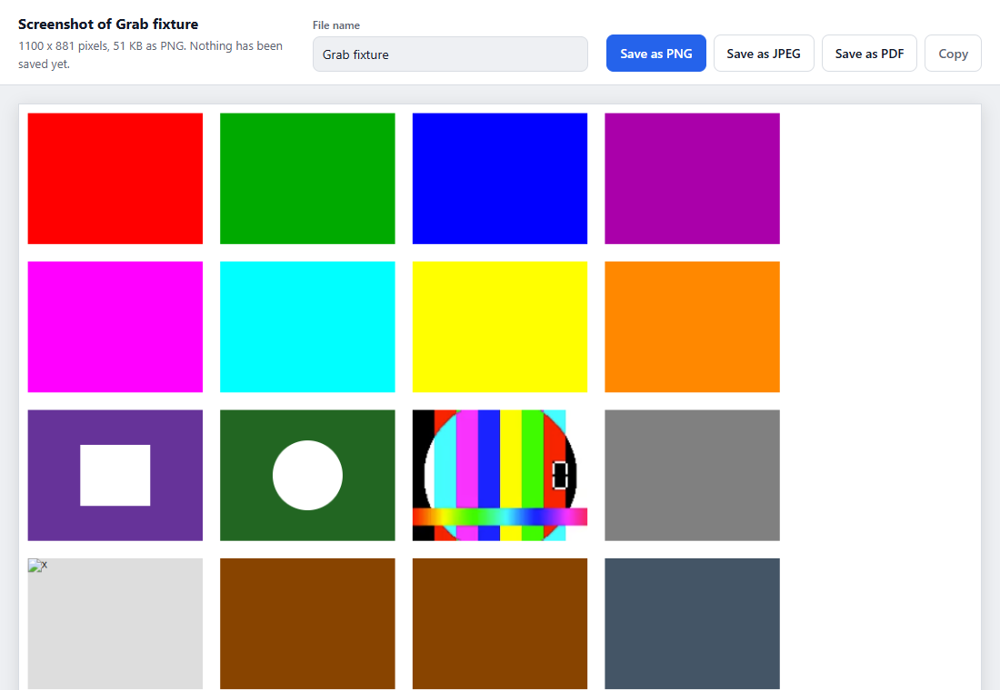
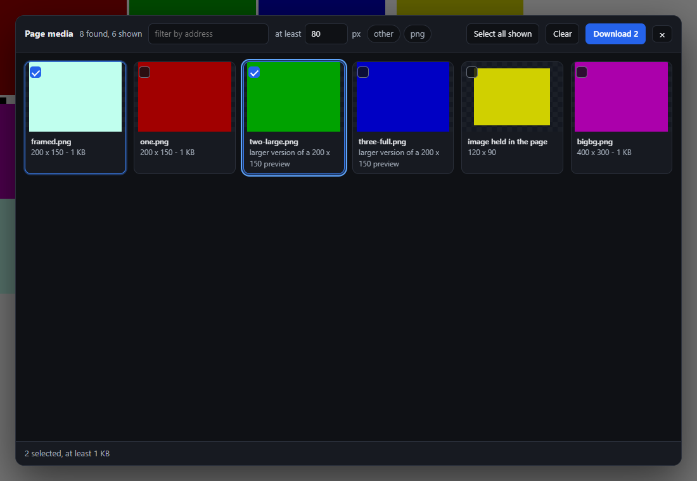
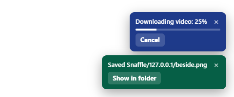
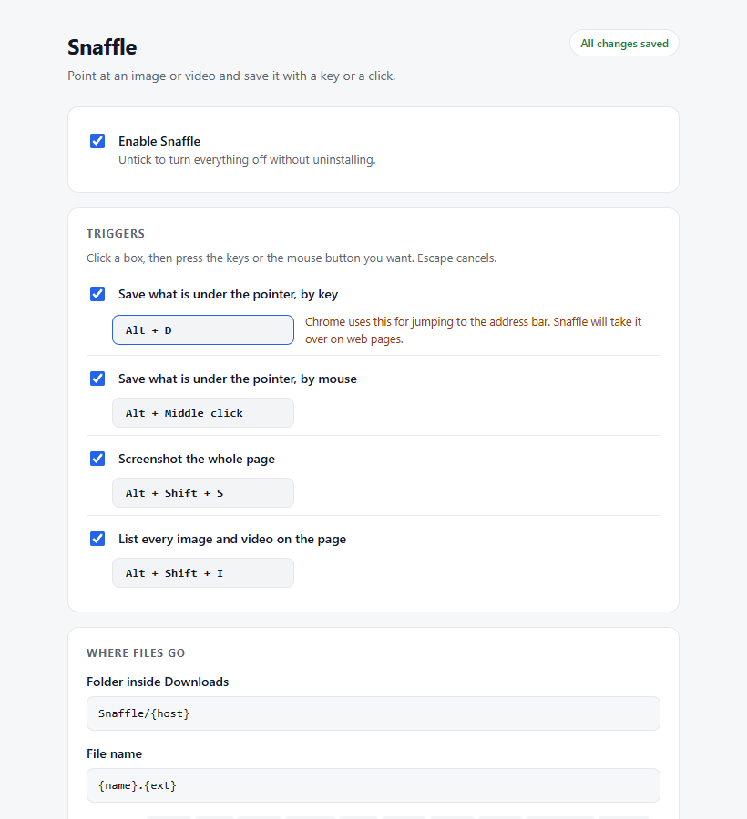

<p align="center">
  
</p>

<h1 align="center">Snaffle</h1>

<p align="center">
  Grab any image or video off a page with a key or a click.<br>
  Rebuild streamed video, capture whole pages, bulk-download the lot.
</p>

---

A Chrome extension that saves whatever image or video is under your mouse pointer, triggered by a key combination or a mouse click you assign yourself.

## Install

Download `snaffle-<version>.zip` from the [latest release](https://github.com/melovibes/snaffle/releases/latest) and unzip it, or clone this repository. Then:

1. Open `chrome://extensions`
2. Turn on **Developer mode** (top right)
3. Click **Load unpacked** and pick the unzipped or cloned folder

Tabs that were already open work straight away: Snaffle loads itself into them when it is installed or updated.

Pin the toolbar icon for a quick on/off switch and a reminder of your triggers.

## Default triggers

| Trigger | Default | Does |
| --- | --- | --- |
| Keyboard | `Alt + S` | save the media under the pointer |
| Mouse | `Alt + Middle click` | save the media under the pointer |
| Keyboard | `Alt + Shift + S` | full-page screenshot |
| Keyboard | `Alt + Shift + I` | open the page media list |
| Right-click menu | — | "Save with Snaffle" on images and video |
| Toolbar popup | — | on/off switch, full-page capture, media list |

Both are reassignable in the options page (toolbar icon → **Open settings**, or the Extensions page → **Details** → **Extension options**). Click the recorder box, then press the key combo or click with the mouse button you want. Either trigger can be turned off independently.

Triggers are suppressed while you are typing in a text field, and the click trigger swallows the follow-up click, `auxclick`, and context menu so the page does not navigate or open a tab.

## What it can find

Detection walks the element stack under the cursor — including shadow DOM and elements hidden beneath transparent overlays, which is how sites like X and Instagram cover their images:

- ``, including `<picture>` / `srcset` and common lazy-load attributes (`data-src`, `data-original`, `data-zoom-image`, …)
- `<video>` and `<audio>` with a real file URL, plus `<source>` children
- CSS `background-image` on any ancestor
- `<canvas>` (exported as PNG when the canvas is not cross-origin tainted)
- inline `<svg>` (serialized)
- links pointing straight at a media file, so a thumbnail wrapped in a link to the full-size JPEG grabs the JPEG

### Full-resolution upgrades

With **Try for the original resolution** on (default), Snaffle picks the largest `srcset` candidate and rewrites known thumbnail URLs:

- X / Twitter → `name=orig`
- Reddit `preview.redd.it` → `i.redd.it`
- Imgur size-suffixed IDs → original
- Wikimedia `/thumb/…` paths → original
- Shopify `_1024x1024` suffixes, Squarespace `?format=750w`
- Image proxies that embed the real URL (Substack, weserv, and similar)
- Generic `?width=&height=&quality=` resize parameters

Signed URLs (AWS signatures, Instagram/Facebook CDNs) are left untouched, since editing them returns a 403.

### Streamed video (X, and other HLS sites)

Video on X is not a file. The player fetches an HLS playlist and feeds small segments to a `MediaSource`, so the `<video>` element only holds a `blob:` URL that refers to memory. Saving it means rebuilding the file.

1. A `webRequest` listener records every `.m3u8` playlist and whole-file `.mp4` a page requests. It judges by the path of the request, ignores navigations, and ignores the extension's own requests.
2. On a grab, the hovered video's poster gives the media id. X repeats that same id in the video URL (`ext_tw_video/<id>/`), so the right playlist is matched exactly even with a dozen videos in one timeline. If the poster carries an id that matches nothing, Snaffle refuses rather than hand you a different video. On sites with no id to match, it takes the most recent stream the page asked for; when the page has loaded more than one, the toast says the result is a best guess.
3. The job is handed to a hidden worker page belonging to the extension, not run in the tab. It does not block other grabs, and it carries on if the tab navigates away or closes.
4. The worker page reads the stream with the bundled [Mediabunny](https://mediabunny.dev) library and writes a real MP4: the best rendition, with a proper index so every player shows the right length and can seek. No re-encoding happens; the audio and video are copied as they are.

That covers the cases plain segment-joining cannot:

- **Audio kept in a separate track** (Reddit and many others) is merged into the one file.
- **MPEG-TS streams** come out as `.mp4`, not `.ts`.
- **Sites that only serve video to their own pages** are handled by a session rule that adds the page's address as `Referer` to the extension's own requests for the length of the job.

The toast shows progress, and **Escape cancels**. Files land as `user-statusid-720p.mp4`, the resolution taken from the track that was saved.

If the library cannot read a stream, Snaffle falls back to joining the best rendition's segments end to end, and the toast says so, because a joined file can show the wrong length in strict players. It will not do that when the audio is separate: a silent file presented as the whole video is worse than an honest failure.

It refuses, with a reason, when a stream is live (it has no end), or is encrypted with DRM. DRM-protected services are not defeated by this and are not meant to be.

Turn the whole thing off with **Rebuild streamed video into one file** in options, which reverts to saving the poster frame.

## Full-page screenshots

`Alt + Shift + S`, or the popup button. Captures the whole scrollable page, not just the window.



The screenshot opens on a page of its own. Nothing is saved until you choose: PNG, JPEG, PDF, or copy it to the clipboard, under a name you can change. If you would rather it saved straight away in a fixed format, the options page has a setting for that.

Chrome only hands an extension the visible part of a tab, so the page is scrolled a screen at a time, each screen is captured, and the shots are stitched together at the position the page actually scrolled to.

What it handles:

- **Fixed bars.** A bar fixed to the top is kept on the first screen only and one fixed to the bottom on the last, instead of both being repeated down the image. Sticky elements are put back where they sit in the page. Bars that only become fixed after scrolling are caught as they appear.
- **Pages that scroll inside a box.** Many web apps never scroll the page itself. Snaffle finds the box that scrolls, keeps what is above it, unrolls its contents, and puts what is below it at the end.
- **Pages that grow as you scroll.** The height is measured again after every screen, so an endless-scroll page is followed to its end, up to 100 screens.
- **Very tall pages.** One image is at most 16,000 pixels tall. A taller page becomes several full-size images (or several pages of one PDF) rather than one enormous or shrunken one, and each piece is finished and released as the capture moves past it, so memory stays flat.
- **Sideways scrolling**, for pages wider than the window. Can be turned off.
- **Switching tabs.** A capture is always of the tab in front. If you switch away, it pauses and says so, and carries on when you come back, rather than photographing the other tab.
- **The real pixel ratio.** The scale is measured from the first shot instead of taken from what the browser reports, which can disagree under zoom or device emulation.
- **Lazy images and animations.** Images in view get a moment to load before each shot, and animations and transitions are stilled for the length of the capture.

A message in the corner shows which screen it is on, with a **Cancel** button; Escape cancels too. Cancelling puts the page back exactly as it was. Snaffle's own messages and panels are never in the picture.

It is paced to stay under Chrome's limit of about two captures a second, so a long page takes a little over half a second per screen.

## Page media list

`Alt + Shift + I`, or the popup button. Opens a dialog of everything on the page, for picking and bulk downloading.



- Collects `` (largest `srcset` candidate, after the full-resolution rewrites), `<video>` files and posters, CSS `background-image`, and links pointing at media files, **across all frames**.
- A thumbnail that links to its full file is one item: the full file.
- Previews reuse what the page has already loaded. Opening the list does not fetch every original just to draw itself.
- Sorted biggest first. Filter by minimum size, by file type, and by address. The size filter is applied again as sizes become known, and a file whose size is not known yet is never hidden by it.
- Click a card or press Space to select. Shift-click selects a range. Arrow keys move between cards, Ctrl+A selects everything showing, and Tab stays inside the dialog.
- Download saves one file at a time through the same path as a single grab: best address first, fallbacks after. The count on screen is the count that really arrived. Anything that could not be saved is named with its reason and left selected.
- Escape, the close button, a click outside, or the trigger again closes it.

## Feedback



Messages appear in the bottom-right corner of the page, and more than one can be up at a time.

- **A saved file** is named with the folder it went to, and has a **Show in folder** button.
- **A video being rebuilt** keeps its own message with a progress bar and a **Cancel** button, while other grabs report beside it.
- **A failure** says what the site did, and stays longer.
- Hovering a message keeps it from disappearing while you read it or reach for its button.

The **Confirm each saved file** setting turns off the first kind only. Problems and downloads in progress are always shown, because silence after a failed grab would look like success.

## Settings and the popup



Every change on the options page is saved as it is made; the pill in the corner says so. To set a trigger, click its box and press the keys or the mouse button you want. Escape cancels.

A shortcut is checked as it is recorded. Snaffle says when Chrome already uses the combination (and that it will take it over on web pages), when Chrome keeps it for itself so it could never fire, when two triggers have been given the same keys, and when a mouse binding would hijack ordinary clicks.

The toolbar popup has the on/off switch, the current triggers, buttons for the screenshot and the media list, the last few files saved (click one to show it in its folder), and a link to the Downloads folder. On a page Snaffle cannot work on it says so instead of offering buttons that do nothing.

## File naming

Two templates in options, both accepting tokens:

| Token | Meaning |
| --- | --- |
| `{name}` `{ext}` | file name and extension from the URL |
| `{host}` | page domain, `www.` stripped |
| `{title}` `{alt}` | page title, image alt text |
| `{kind}` | `image`, `video`, or `audio` |
| `{date}` `{time}` `{datetime}` `{ts}` | timestamps |
| `{index}` | zero-padded running counter |

Defaults: folder `Snaffle/{host}`, name `{name}.{ext}` — so a photo from example.com lands in `Downloads/Snaffle/example.com/`. The options page shows a live preview of the resulting path. Characters Windows rejects are replaced with `_`; spaces and dashes are kept.

## How downloads are attempted

Every address Snaffle works out is a guess about a server it does not control, so a grab carries a list of candidates: the rewritten full-resolution address first, then the un-rewritten one, ending with the address the page itself loaded.

1. **Downloads API**, one candidate at a time. Snaffle waits for the server's answer before saying anything. A refusal, a 404, or a web page served where a file should be moves it to the next candidate, and the rejected download is removed from disk and from Chrome's list.
2. **Page-context fetch** of the page's own address if every candidate fails. The page's cookies and `Referer` apply, which defeats most hotlink protection.
3. **Worker-page fetch** as a last resort, with no page cookies.

"Saved" appears only once a real file of the right kind is arriving. If all three fail the toast says why, and nothing is left behind.

Bytes that exist only in the page (an encoded canvas, an inline SVG, a screenshot, a file recovered by step 2) are passed in chunks to the extension's worker page, which hands them to the downloader as a blob. They land in your folder like everything else, at any size.

Once the server has said what a file really is, its extension is corrected to match: a `.jpg` address that serves WebP is saved as `.webp`.

Nothing in this chain ever returns fetched bytes to a web page. The worker page only accepts instructions from the service worker; the single thing a page can send it is bytes to be saved.

## Files

| File | Role |
| --- | --- |
| `manifest.json` | MV3 manifest |
| `shared.js` | defaults, config handling, labels, file naming, content-type rules; used by every other part |
| `content.js` | in every frame: hover tracking, media resolution, triggers, toast and outline |
| `background.js` | service worker: decides what is downloaded and where, tracks stream playlists, loads features into tabs |
| `offscreen.html/.js` | hidden worker page: rebuilds streamed video, holds large files as blobs |
| `hls.js` | playlist reading for the fallback segment-joiner |
| `vendor/mediabunny.min.mjs` | [Mediabunny](https://mediabunny.dev) 1.65.2, unmodified, MPL-2.0 (licence alongside) |
| `capture.js` | full-page screenshot; loaded into a tab only when asked for |
| `result.html/.css/.js` | the page a screenshot opens on, to check it and choose how to save it |
| `pdf.js` | a minimal PDF writer: one JPEG per page |
| `gallery.js` | page media list; loaded into a tab only when asked for |
| `options.html/.css/.js` | settings with key and mouse recorders |
| `popup.html/.css/.js` | on/off switch, trigger summary, capture and list buttons |
| `test/snaffle.test.js` | offline checks of the pure logic: `npm test` |
| `test/browser/` | the real extension in headless Chromium against local fixtures: `npm run test:browser` |
| `docs/phase0-findings.md` | what the first browser run found, and what is still open |
| `icons/`, `tools/make-icons.ps1` | icon set and the script that regenerates it |

Only `shared.js` and `content.js` run in every frame of every page. The screenshot and media-list code is loaded into a tab by the service worker when a key or the popup asks for it.

Settings are stored as differences from the defaults, not as a full copy, so a default that changes in a later version reaches everyone who never touched that setting.

## Icon

`icons/logo.png` is the master. Regenerate the set with:

```
pwsh -File tools/make-icons.ps1
```

32, 48 and 128 are resampled from the master. **16 is different artwork** — the full logo (claw, photo tile, sun, hills) turns to mush at 16 pixels, so the toolbar icon is the claw alone, which is the only part whose silhouette survives. Size-specific artwork is normal practice; Chrome picks the right file per context.

## Tests

```
npm install
npm test              # 126 offline checks, a second or two
npm run test:browser  # 83 checks in headless Chromium, about nine minutes; needs ffprobe on the PATH
node test/browser/shots.js   # retake the screenshots in docs/img
npm run package       # build snaffle-<version>.zip, the files that ship and nothing else
```

**Offline checks** cover the pure logic: URL rewriting per site, `srcset` parsing, playlist reading, file naming, config storage and migration, shortcut warnings, content-type verdicts, stream grouping, the PDF writer's byte offsets, static wiring between the scripts, the manifest and the HTML, and a handful of accessibility rules (no focus ring removed without a replacement, no text under 12px, controls named for what they do).

**Browser checks** load the shipped files into headless Chromium and drive them with real pointer and keyboard input against fixture pages served from two local origins. Each result is checked three ways: the toast, Chrome's own download record, and the fixture server's request log. Saved bytes are read back: a rebuilt video is run through `ffprobe` for its tracks, frame count and length, and a screenshot is decoded and sampled. The streams are real ones made with ffmpeg, including split-audio, multi-rendition, MPEG-TS and Referer-guarded variants. The options page, the popup and the media list are driven the way a user would, keyboard included.

A defect that is understood but not yet fixed goes in `KNOWN_FAILING` at the top of `test/browser/run.js` with a note. The run fails on anything outside that list, and also when a listed check starts passing, so the list cannot go stale. It is empty at the moment.

Not covered by automation: real sites (they need a signed-in browser), a physical high-DPI display, the popup as Chrome shows it from the toolbar (it is tested opened as a page and pointed at a tab), the "Show in folder" buttons actually opening a folder, the file-extension correction (Chrome skips that hook when downloads are driven by the automation protocol), and the fresh copy injected into open tabs after an update (an unpacked extension does not come back from a reload under automation).

## Troubleshooting

**Something else happens instead of a download.** Chrome owns several click gestures on links, and X, Reddit, and most feeds wrap their media in links:

| Gesture | What Chrome does |
| --- | --- |
| `Ctrl + Alt + Click` | opens the link in **split view** |
| `Middle click` | opens the link in a new tab |
| `Alt + Click` | downloads the link target |
| `Ctrl + Click` | opens in a background tab |
| `Alt + D` | focuses the address bar |

When it recognizes your trigger, Snaffle hides `pointerdown` from the page and cancels the rest of the click sequence (`mousedown` through `auxclick`), which blocks these. If a browser gesture still fires, Snaffle did not see the click:

1. **See whether the page is one extensions cannot touch.** `chrome://` pages, the Web Store and other extensions' pages are off limits; the popup says so when you use its buttons there.
2. **Check the combination matches exactly.** The trigger requires those modifiers and no others — `Ctrl + Alt + Middle click` does not fire a trigger set to `Alt + Middle click`, so Chrome handles it instead.
3. **Look for a message in the corner.** A warning or an error means Snaffle saw the click. If you have turned confirmations off, a successful save is silent, so check the popup's "Recently saved" list instead.
4. **Confirm it is on.** Toolbar icon, master switch, and the per-trigger on/off state.

**A video on X saves the poster image instead of the video.** Snaffle never saw the playlist, because the video has not been played yet. Let it start, then grab. The playlist is recorded the moment the player requests it.

**"Snaffle was updated. Reload this page to use it here."** The copy of Snaffle in that tab lost contact with the extension and was not replaced. Reloading the page fixes it.

**A saved video is marked "saved as joined segments".** The stream could not be read by the converter, so its pieces were joined as they are. It will play in VLC and browsers; a strict player may show the wrong length. `ffmpeg -i in.mp4 -c copy out.mp4` rewrites it properly.

## Notes and limits

- Chrome does not run extensions on `chrome://` pages, the Web Store, or other extensions' pages — nothing will happen there.
- DRM-protected video cannot be saved.
- Permissions, and why each is there: `<all_urls>` because media can be on any site and screenshots need it; `webRequest` to see the video playlist URLs a page requests; `scripting` to load Snaffle into tabs that were open before it was installed, and to load the screenshot and media-list code on demand; `offscreen` for the hidden worker page; `declarativeNetRequestWithHostAccess` to add a `Referer` to the extension's own video requests. Chrome describes that permission as reading your browsing history. Nothing is read off-page and nothing is sent anywhere — recorded playlist URLs live in `chrome.storage.session`, which is memory-only, cleared when Chrome closes, and pruned after two hours. Downloads go straight to your disk.
- Settings live in `chrome.storage.sync`, so they follow your Chrome profile across machines.
- Rebuilding a streamed video holds the finished file in memory before saving it, so a very long video needs that much free memory.

## Licence

Snaffle is released under the [MIT licence](LICENSE): use it, change it and share it, as long as the copyright notice stays with it.

It bundles one third-party library, [Mediabunny](https://mediabunny.dev), unmodified, under the Mozilla Public License 2.0. That file keeps its own licence, whose text is in `vendor/`.
